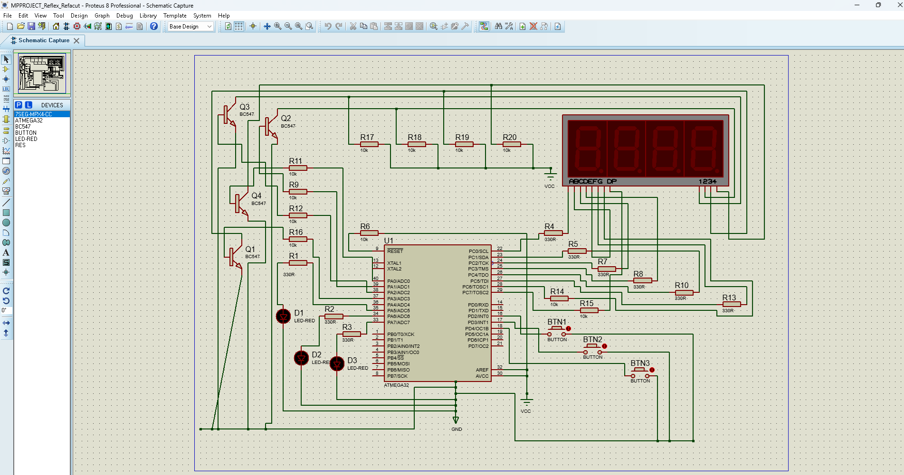

# ATmega32 Reflex Test

**ATmega32 at 8 MHz · Proteus · Four-digit seven-segment display**

A reaction-time game with three buttons. The display shows `0000`, waits 0.5 to 8 seconds, then shows `1`, `2`, or `3`. Press the matching button to see your reaction time in seconds. In the included v3 firmware, the result stays on screen for three seconds before the next round begins automatically.

## Simulation demo

[Watch the demonstration (MP4)](./demo.mp4)

The recording shows the earlier v2 firmware displaying the target and measuring a response. The included v3 firmware adds automatic restart.

## Connections

| Component | ATmega32 pins |
| --- | --- |
| BTN1, BTN2, BTN3 | PD2, PD3, PD4 |
| Display segments A–G and DP | PC0–PC7 |
| Display positions 1–4 | PA2, PA1, PA3, PA0 via BC547 transistors |

The schematic uses four 10 kΩ pull-ups on the display commons. The Proteus display model has **Minimum Trigger Time** set to `0.1 ms`.

## Run in Proteus

1. Open [the Proteus project](./Placa_Simulata.pdsprj).
2. Keep [reflex.hex](./reflex.hex) beside the project. If prompted, select it in the ATmega32 **Program File** field.
3. Set **Clock Frequency** to **8 MHz** and press **Run**.

## Source code

- [C source for Microchip Studio](./reflex.c) implements the game using Timer0 CTC and an interrupt for display multiplexing. To build it, create a **GCC C Executable Project** for **ATmega32**, put the source in `main.c`, and use **Build Solution** with `-Os`. Select the newly generated HEX in Proteus to run this build.
- [AVR assembly source](./reflex_v3.asm) corresponds to the bundled `reflex.hex`.

## Project sheet

[Project sheet in Romanian (PDF)](./Fisa_proiect.pdf)
